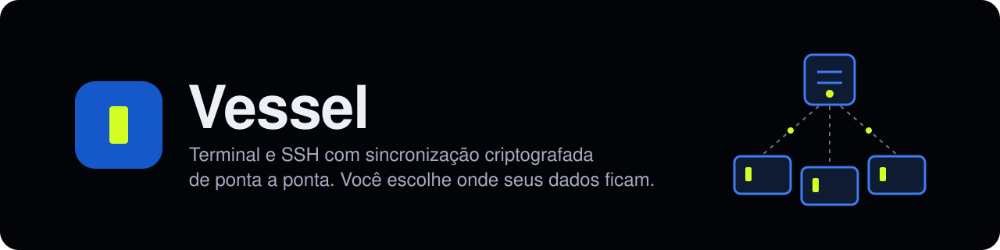
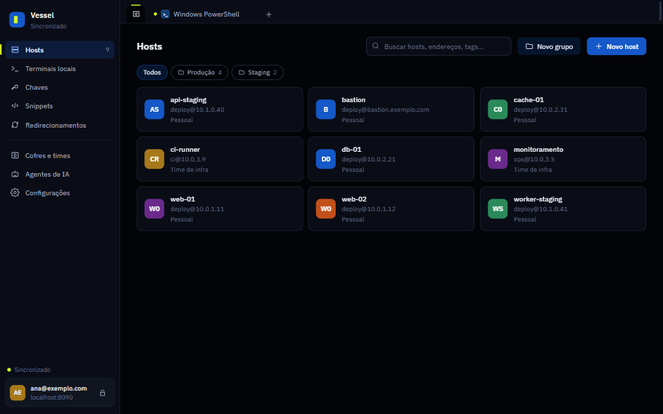
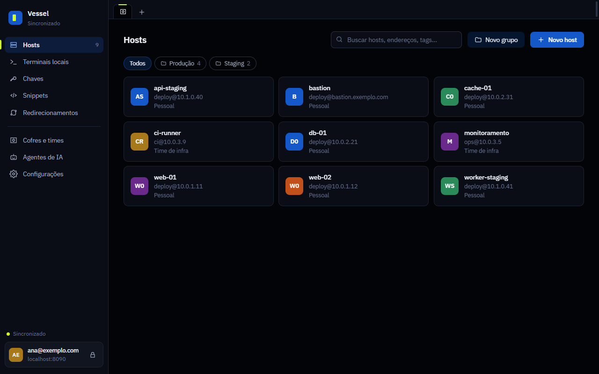
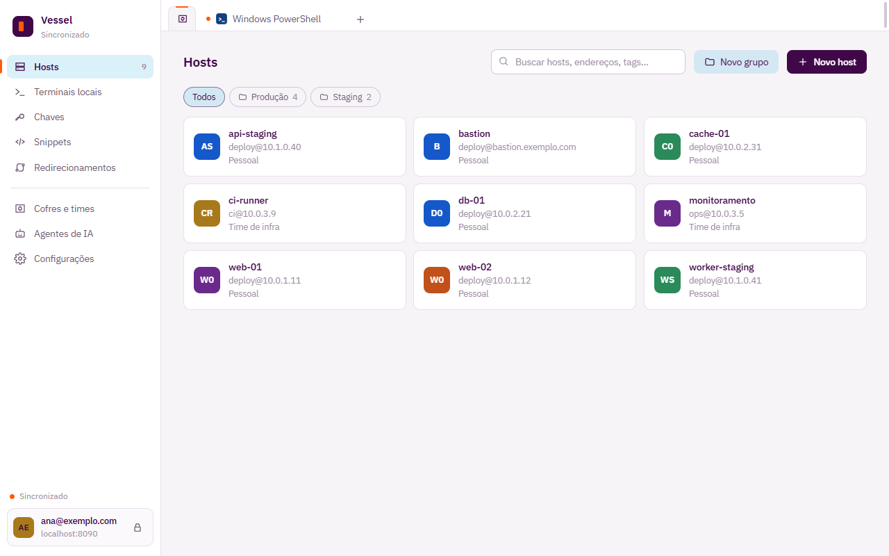
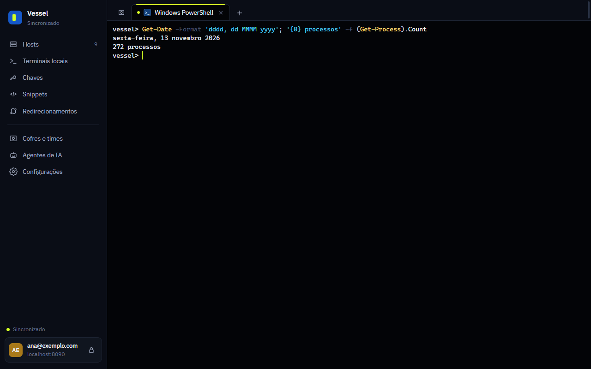
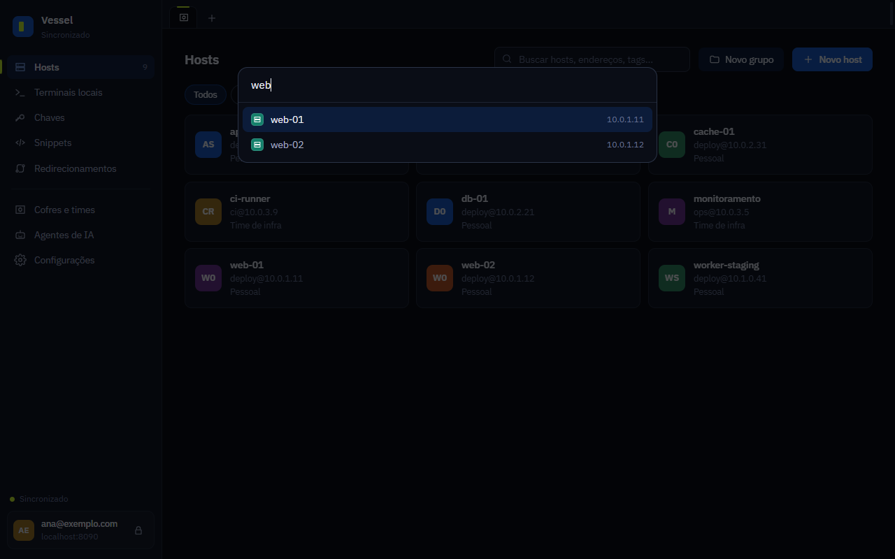
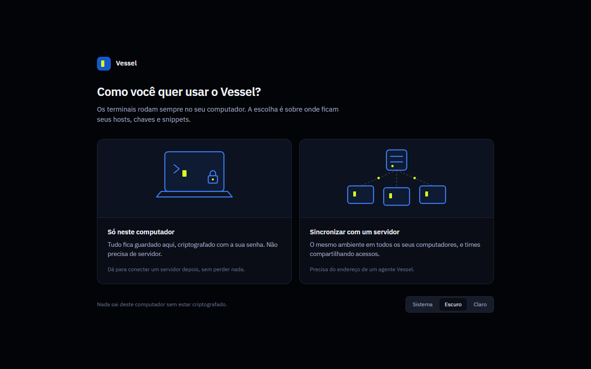
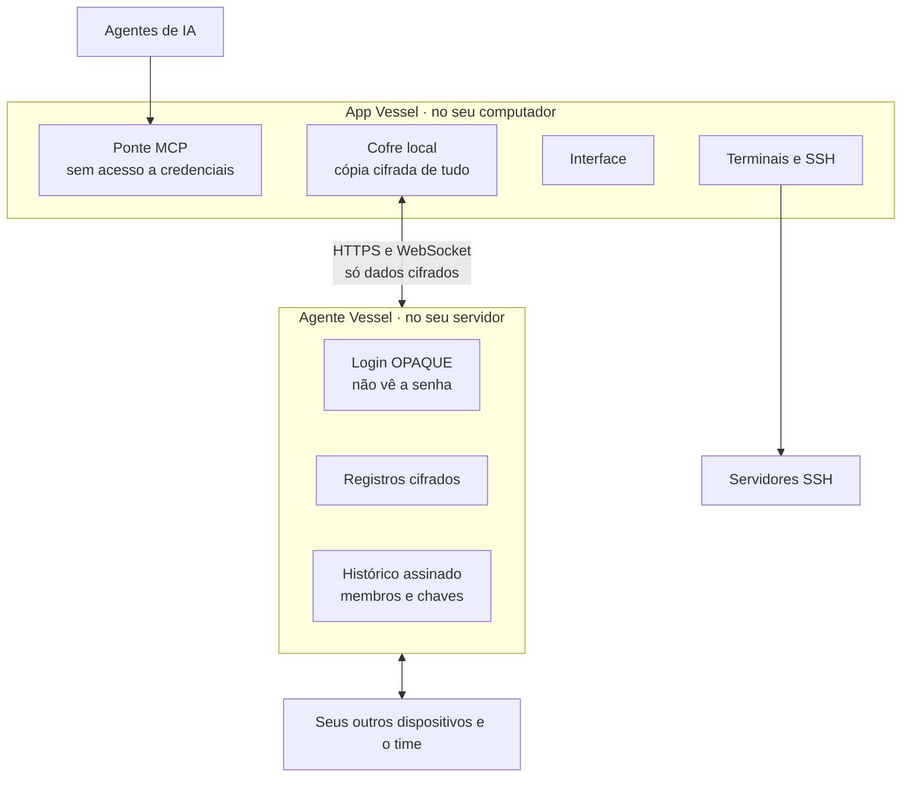
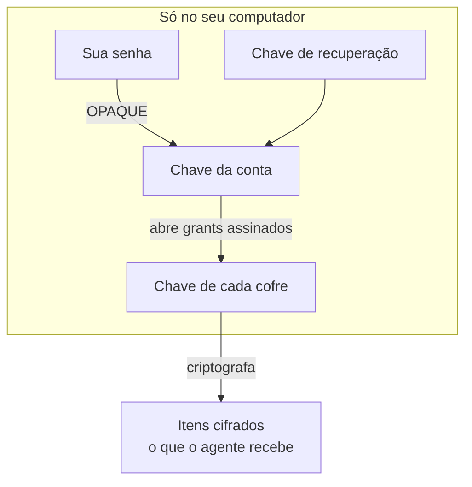

<p align="center">
  
</p>

<p align="center">
  <a href="#licença"></a>
  
  
</p>

O **Vessel** é um cliente de terminal e SSH para desktop. Ele guarda seus hosts, chaves, snippets e redirecionamentos de porta criptografados, e os sincroniza entre os seus computadores e o seu time **sem que o servidor consiga ler nada**.

Você escolhe onde os dados ficam: só no seu computador, ou num servidor de sincronização que você mesmo roda.

<p align="center">
  
</p>

## Por que o Vessel

- **Seus dados, seu lugar.** Use só no seu computador, sem conta e sem servidor. Ou conecte a um agente de sincronização que você hospeda. Não existe nuvem obrigatória.
- **O servidor não lê nada.**
  - Tudo é criptografado no seu computador antes de sair.
  - A senha nunca é enviada: o login usa [OPAQUE](https://datatracker.ietf.org/doc/rfc9807/).
  - Quem opera o servidor não vê hosts, senhas nem chaves.
- **Feito para times.** Cofres compartilhados com papéis (dono, admin, editor, leitor), convites, aprovação por impressão digital e troca automática da chave quando alguém sai.
- **Agentes de IA com limites.** Assistentes compatíveis com MCP podem abrir terminais, rodar snippets e organizar hosts, mas nunca leem nem alteram senhas, chaves privadas ou passphrases.

## Recursos

- **SSH:**
  - Senha, chave (com ou sem passphrase) e identidades reutilizáveis.
  - Jump hosts encadeados e confirmação da chave do servidor no primeiro acesso.
  - Keepalive e snippet de inicialização.
- **Terminais locais:** PowerShell, Prompt de Comando, WSL e Git Bash são detectados sozinhos. Você também pode criar perfis próprios.
- **Organização:** grupos com credenciais herdadas, tags, busca e paleta de comandos (`Ctrl+K`).
- **Redirecionamento de portas:** local (`-L`), remoto (`-R`) e SOCKS (`-D`). O app avisa antes de abrir uma porta para a rede.
- **Snippets:** scripts salvos que você revisa antes de rodar num terminal.
- **Sincronização:** em tempo real entre computadores. Conflitos de edição são mesclados campo a campo.
- **Migração sem perda:** dá para começar só no computador e conectar um servidor depois, ou o contrário. Antes de migrar, o app faz um backup criptografado.
- **Temas claro e escuro**, bloqueio automático por inatividade e chave de recuperação para quando esquecer a senha.

<table>
  <tr>
    <td></td>
    <td></td>
  </tr>
  <tr>
    <td></td>
    <td></td>
  </tr>
</table>

## Começar

> O Vessel está na versão 0.1. Por enquanto o instalador é só para Windows. macOS e Linux estão nos planos.

1. Baixe o instalador na página de [Releases](https://github.com/thalesleall/vessel/releases), ou [compile a partir do código](#compilar-a-partir-do-código).
2. Na primeira tela, escolha como usar:

<p align="center">
  
</p>

- **Só neste computador:** você cria uma senha e recebe uma chave de recuperação. Tudo fica criptografado no seu disco.
- **Sincronizar com um servidor:** informe o endereço do seu agente Vessel e crie a conta, ou entre numa conta existente. A primeira conta de um servidor novo vira a administradora e precisa do código de instalação que aparece no log do agente.

## Rodar o seu servidor

O agente de sincronização é um único binário com SQLite, distribuído como imagem Docker, com o Caddy na frente cuidando do HTTPS.

```bash
cd deploy
cp .env.example .env      # defina VESSEL_DOMAIN
docker build -f ../apps/agent/Dockerfile -t vessel-agent:latest ..
docker compose up -d
docker compose logs agent # mostra o código de instalação da primeira conta
```

Pelo próprio app, a conta administradora:
- convida pessoas;
- acompanha o uso do servidor;
- suspende ou exclui contas;
- define cotas de espaço.

Os administradores não veem o conteúdo de nenhum cofre. O backup do servidor sai criptografado (`vessel-agent backup`).

As variáveis, a administração, os backups, a escala e o checklist de release estão em [docs/OPERATING.md](docs/OPERATING.md).

## Como funciona

O app faz toda a criptografia. O agente guarda e repassa apenas dados cifrados, e as conexões SSH vão direto do seu computador aos servidores, sem passar por ele.



Cada camada de chave protege a próxima. Só a última camada, os itens já cifrados, sai do seu computador:



- **Itens:** cada item é cifrado com XChaCha20-Poly1305. O envelope autentica o cofre, o item, a versão da chave, a versão do item e a marcação de exclusão. Assim o servidor não consegue trocar itens de lugar, devolver uma cópia antiga nem forjar uma exclusão.
- **Membros:** a entrada e a saída de membros ficam num histórico encadeado e assinado (Ed25519), verificado por cada app.
- **Chaves dos cofres:** chegam a cada membro por HPKE, assinadas por quem gerencia o cofre.
- **Saída de um membro:** a chave do cofre é trocada e os itens são recifrados.
- **Chaves já conferidas:** sincronizam pelo cofre pessoal, então um computador novo parte do que os outros já verificaram.

### O que o servidor vê

O agente não tem como decifrar o conteúdo, mas guarda metadados em claro:
- e-mails;
- nomes de dispositivos;
- quem é membro de qual cofre e com qual papel;
- datas e tamanhos dos registros.

Hoje, a primeira chave pública de cada pessoa é aceita no primeiro contato (TOFU). Por isso, ao aprovar um membro, o app pede que você digite a impressão digital informada pela pessoa por outro canal.

Detalhes em [docs/ARCHITECTURE.md](docs/ARCHITECTURE.md).

## Agentes de IA (MCP)

Em **Agentes de IA**, ative o servidor MCP local (`127.0.0.1:47011`) e copie o token. Assistentes que usam MCP por stdio se conectam com a ponte `vessel-mcp`:

```bash
vessel-mcp --token <token>
```

- **O agente pode, por padrão:** ver o estado do app, os cofres e os itens (sem segredos), abrir terminais, conectar a hosts já confirmados, ler a saída dos terminais e iniciar redirecionamentos locais.
- **O agente pode, se você liberar:**
  - digitar nos terminais, rodar comandos e snippets;
  - criar ou editar hosts, grupos, snippets, perfis e redirecionamentos.
- **O agente nunca pode:**
  - ler ou alterar senhas, chaves privadas e passphrases;
  - aceitar a chave de um servidor novo;
  - abrir uma porta para a rede;
  - mexer nas confirmações de confiança.

## Compilar a partir do código

Pré-requisitos:
- [Rust](https://rustup.rs) 1.90 ou mais novo;
- [Node.js](https://nodejs.org) 22 ou mais novo;
- os [pré-requisitos do Tauri](https://v2.tauri.app/start/prerequisites/) (no Windows, WebView2 e as Build Tools do Visual Studio);
- Docker, só para o laboratório de testes SSH.

```bash
git clone https://github.com/thalesleall/vessel.git
cd vessel/apps/desktop
npm install
npx tauri dev     # app em modo de desenvolvimento
npx tauri build   # instalador em target/release/bundle
```

Testes:

```bash
cargo test --workspace
cargo clippy --workspace --all-targets -- -D warnings
```

Os testes de SSH real usam um laboratório em Docker (bastion, jump host e alvo). Como subir o laboratório e o roteiro de testes manuais estão em [docs/TESTING.md](docs/TESTING.md).

### Estrutura

| Pasta | O que é |
|---|---|
| `apps/desktop` | App Tauri: interface em SolidJS e backend em Rust (SSH, terminais, MCP) |
| `apps/agent` | Agente de sincronização (axum e SQLite) |
| `apps/mcp-bridge` | `vessel-mcp`, a ponte stdio para assistentes de IA |
| `apps/devtool` | `vessel-dev`, um segundo usuário em linha de comando para testar times |
| `crates/vessel-crypto` | Toda a criptografia: OPAQUE, envelopes, grants, histórico de membros, backups |
| `crates/vessel-client` | Lógica do cliente: contas, cofres, sincronização, migração |
| `crates/vessel-protocol` | Tipos da API entre o app e o agente |
| `crates/vessel-model` | Itens sincronizados e mesclagem de conflitos |
| `deploy` | Docker Compose, Caddy e o laboratório de desenvolvimento |

## Status

Versão 0.1. Os modos local e com servidor próprio estão completos e cobertos por testes automáticos e por um laboratório de SSH real.

Ainda falta:
- instaladores assinados;
- macOS e Linux;
- verificação de e-mail e cobrança, que só são necessárias para quem quiser oferecer o agente como serviço.

## Contribuir

Issues e pull requests são bem-vindos. Antes de abrir um PR, rode os testes e o clippy acima.

Mudanças na criptografia ou no protocolo precisam de um teste que demonstre a propriedade de segurança envolvida. Os testes em `crates/vessel-client/tests` servem de modelo.

Falhas de segurança: por favor, não abra uma issue pública. Use o [aviso privado de vulnerabilidade](https://github.com/thalesleall/vessel/security/advisories/new) do GitHub.

## Licença

Licenciado sob a sua escolha de:

- Apache License, versão 2.0 ([LICENSE-APACHE](LICENSE-APACHE))
- Licença MIT ([LICENSE-MIT](LICENSE-MIT))

Salvo declaração em contrário, qualquer contribuição enviada para inclusão no projeto é licenciada como acima, sem termos adicionais.
